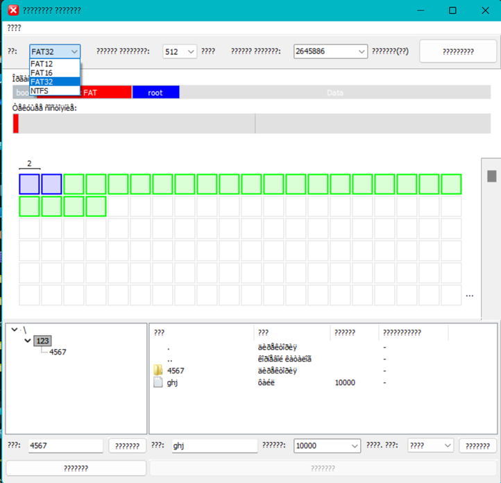
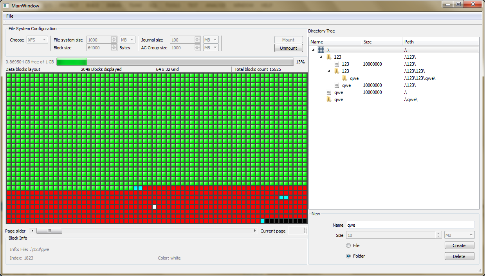

# History

Our teacher showed us the first version of the program, written in Delphi, and gave
our group lab assignments. We built the second version from scratch in C++. Now I have
written it in Rust; it even runs in the browser.

| v1, Delphi | v2, C++ |
|---|---|
|  |  |
